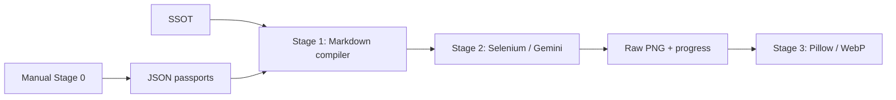
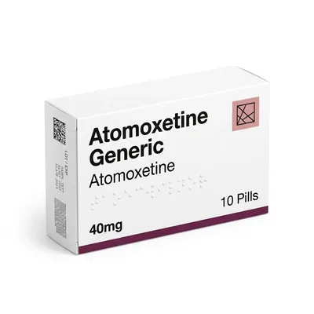

# PharmaGen PRO

An operator-assisted pipeline that turns pharmaceutical product records into packaging prompts, browser-generated packshots and optimized WebP images.

> **Portfolio migration candidate.** Local privacy/history cleanup is prepared. Publication awaits approval of exact branch and tag replacements. Remote master and the backup branch have not been changed. [Current audit](docs/portfolio-audit.md).

## Project Overview

PharmaGen PRO combines a single source of truth (SSOT), packaging passports and a resumable three-stage CLI. Product analysis and JSON passport preparation are a separate manual Stage 0. The automated stages compile prompts, drive an authenticated Gemini browser session and process downloaded images.

## Problem Statement

The owner's project brief describes an e-commerce catalogue with outdated photos, low-resolution images and time-consuming reference searches. Repeated Photoshop work made it difficult to standardize composition and delivery format across the catalogue. This is reported project context, not a measured productivity claim.

## Solution

Structured product records and packaging passports separate product identity from visual instructions. SSOT routing, design rules and templates feed Selenium/Gemini RPA. Downloaded PNGs pass through a WebP processor. Progress records, retries and validation support attended operation and recovery.

## Key Features

- SSOT-driven packaging routing, geometry, colour rules and prompt generation.
- Browser automation with strict chat-cleanup checks in the current implementation.
- Sequential subprocess stages, centralized YAML configuration and run logs.
- File-based resume and retry handling.
- Image resizing and iterative WebP quality reduction toward a configured byte limit.
- Passport checks and OCR QA helpers; human visual acceptance remains necessary.

## System Architecture



`main.py` launches `src.passport_generator`, `src.rpa_orchestrator` and `src.image_processor` as separate subprocesses. Stage 0 is outside this command. [Architecture and failure boundaries](docs/ARCHITECTURE.md); [editable diagram](docs/diagrams/pipeline.mmd).

## Technology Stack

Python 3.10+, Selenium, Chrome, webdriver-manager, Pillow, PyYAML, rich and Pydantic. Optional OCR diagnostics use pytesseract and Tesseract. [requirements.txt](requirements.txt) uses version lower bounds, not a lockfile. A new isolated Python 3.10.11 environment installed these requirements and passed dependency, CLI and unit checks; see [test results](FINAL_TEST_RESULTS.md).

## Repository Structure

| Path | Responsibility |
|---|---|
| `main.py`, `src/` | CLI, configuration and the three runtime stages |
| `pharma_pkg/`, `schemas/`, `verification_agent.py` | Packaging models, routing and validation helpers |
| `SSOT/` | Catalogue, design rules and supporting source documents |
| `pipeline/passports/` | JSON inputs prepared in Stage 0 |
| `pipeline/cv/` | Retained structured analysis evidence |
| `input/` (local, ignored) | Source photos for manual Stage 0; third-party rights review pending |
| `.agents/protocol.md`, `.agents/workflows/` | Manual preparation guidance; proposed schemas remain roadmap material |
| `scripts/`, `tests/` | Auxiliary tools and unit tests |
| `docs/` | Architecture, evidence, runbooks and historical assessments |

Generated prompts, images, diagnostics and resume state are ignored. Existing local copies remain available and committed history is preserved in the external backup. Fresh clones require regeneration or an authorised restore. [Cleanup decisions](CLEANUP_MANIFEST.md).

## Quick Start

From the repository root on Windows:

```powershell
python -m venv venv
venv\Scripts\python.exe -m pip install -r requirements.txt
venv\Scripts\python.exe main.py --help
venv\Scripts\python.exe -m unittest discover -s tests -p "test_*.py"
```

Use a disposable working copy for verification. Stage 1 writes prompts, a verifier log and a generated audit report:

```powershell
venv\Scripts\python.exe main.py --passports-only
venv\Scripts\python.exe main.py --passports-only --resume
```

Follow [DEPLOYMENT.md](DEPLOYMENT.md) for browser setup and artifact restore. Do not run the full pipeline as an installation test.

## Configuration

[config.yaml](config.yaml) controls inputs, outputs, logging, resume state and browser settings. Copy [config.example.yaml](config.example.yaml) to ignored `config.local.yaml`, set a dedicated authorised browser profile/downloads directory and select it explicitly:

```powershell
venv\Scripts\python.exe main.py --config config.local.yaml --render-only --limit 1
```

`PHARMAGEN_CONFIG` selects a config file; `PHARMAGEN_HEADLESS` and `PHARMAGEN_DEBUG` override their settings. Relative `paths.*` resolve against the project root. Use absolute browser profile/download paths in local configuration. Default profile/download paths are derived per user with Path.home(); local overrides remain ignored.

Committed dev configuration writes to `output/test1`; built-in defaults use `output`. Keep the same explicit config when resuming. Neither location implies a complete delivery.

## Pipeline Stages

| Stage | Input | Output | Execution |
|---|---|---|---|
| 0 — Preparation | Source photos and metadata | JSON passports | Manual, outside `main.py` |
| 1 — Prompt compilation | JSON passports + SSOT | Markdown prompts | Local Python |
| 2 — Rendering | Markdown + Gemini session | Raw PNG + progress | Attended Selenium/Chrome |
| 3 — Processing | Raw PNG/JPEG | WebP | Local Pillow |

```powershell
venv\Scripts\python.exe main.py --render-only --limit 5
venv\Scripts\python.exe main.py --process-images-only --resume
venv\Scripts\python.exe main.py --full --resume
```

These are operational commands, not evidence of rendering during this audit. Review [OPERATIONS.md](OPERATIONS.md): the renderer includes chat-history deletion.

## Verified Results

Measured on **2026-11-18**, from dev `df31165` and its local cleanup candidate. [Evidence and definitions](docs/portfolio-evidence.md) distinguish historical assets from newly executed checks.

| Measurement | Observed result |
|---|---|
| Current source records | 391 unique CSV picture IDs, 391 master registry entries, 391 JSON passports |
| Isolated Stage 1 | 391/391 Markdown files generated; resume skipped the completed stage |
| Previous raw set | 391 archived PNG files; current raw directory contains 7 |
| Historical final set | 389 WebP files, all 1600×1600; largest 134,630 bytes, all within 500 KiB |
| Missing historical finals | SKU 132 and 218 |
| Later test batch | 9 WebP files in `output/test1`, not a complete catalogue run |
| Baseline unit tests | 18 run: 17 passed, 1 failed due to warning-order coupling in a test |
| Candidate unit tests | 18 run: 18 passed, 0 failed, 0 skipped after correcting the test's warning selection |
| Browser/Gemini end-to-end | **NOT VERIFIED** in this audit |

Candidate test counts and before/after comparisons are in the [audit](docs/portfolio-audit.md). Dimensions, decoding and byte checks do not establish medical, text, packaging or brand correctness.

## Known Limitations

- Stage 0 is manual. The complete workflow is not autonomous.
- Rendering requires an authenticated Gemini browser and typically non-headless Chrome. Selectors, account state, UI changes and service instability affect operation.
- Image generation is non-deterministic; rerunning a prompt does not reproduce historical images.
- Catalogue-wide visual acceptance is unverified. No medical or regulatory approval is implied.
- Stage 1 resume compares counts, not IDs or hashes. Stage 3 skips existing filenames without revalidating their content.
- Stage 3 may log per-file failures and still exit successfully. A configured byte limit is a target, not an unconditional guarantee.
- Browser-specific configuration and unpinned dependencies limit portability.
- Historical credential revocation and browser session review are owner-confirmed. Remote replacements require explicit approval.

## My Contribution

**Owner-reported, from the 2026-11-18 brief:** identified the e-commerce workflow problem; formulated requirements; designed the architecture, SSOT and data contracts; organized AI-assisted implementation and coordinated AI coding agents; reviewed results; and participated in deployment to one commercial storefront. Storefront adoption and personal authorship were not independently verified by this audit. This does not claim that all Python was manually written by the owner.

## Visual Demo

Only real, source-traced examples may be included. The pipeline diagram documents implemented behaviour; it is not an output screenshot. Product examples and their provenance are listed in [demo assets](docs/assets/README.md). No synthetic verification fixture is presented as a commercial result.



Historical generated concept packshot, copied from the existing 400×400 preview. Not a new render, validated product label or approved packaging. The branded source photo is withheld pending third-party rights confirmation.

## Project Status

**PARTIALLY COMPLETED / BLOCKED — NOT READY for LinkedIn publication.** The locally rewritten candidate preserves mapped dev ancestry and runtime inputs. Public PR, master promotion, default-branch switching and legacy branch retirement await exact-ref approval and post-update checks. Historical tags are not current acceptance evidence. [Plan](MIGRATION_PLAN.md), [baseline](BASELINE_REPORT.md), [rollback](ROLLBACK_PLAN.md), [audit](docs/portfolio-audit.md).

## License / Usage Restrictions

The owner explicitly authorised public publication of the project's source code, images, catalogue data, documentation and results on 2026-11-18, asserting ownership or authority to grant permission. This supersedes the former Pharma Progressive internal-publication restriction. **All rights reserved; no open-source licence or blanket permission to reuse third-party trademarks is granted.** Secrets, browser sessions and personal data are excluded. See [publication authorisation](docs/PUBLICATION_AUTHORIZATION.md).
